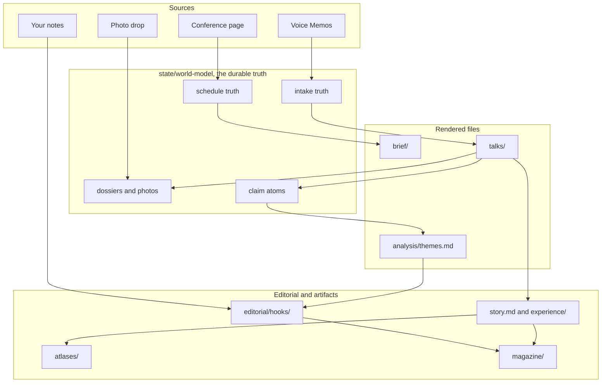

# Conference Reporter

One directory, one repo, one conference. This repo is an OpenProse program that
keeps one conference's schedule current: every session, speaker, room, and start
time, plus an append-only record of what changed. It also turns the recordings
you make into talks you can read, cite, and write from.

The schedule comes from the conference's own page. The talks come from Voice
Memos. Everything else is derived from those two, and every claim keeps its
citation.

This directory is the **template**. It ships the program, contracts, skills, and
design language, and no conference data. `brief/`, `state/`, `talks/`,
`recordings/inbox/`, `photos/`, `site/`, `analysis/`, `notes/inbox/`, `editorial/`,
`explainers/<slug>/`, `atlases/<slug>/`, and `magazine/<issue>/` are ignored by
the "conference build data" block in `.gitignore`. A build deletes that block.

## How data flows



Four sources feed the program. The conference page is **declared**: it is what
the event says about itself. Voice Memos and the photo drop are **observed**:
they are what actually happened in the room. Your notes are **captured** by hand.
The claim atoms and the themes are **derived** from the talks.

Each node keeps a world-model under `state/world-model/<node>/`. A node renders
only when its contract or an input fingerprint moved. Every render writes a
receipt, so `runs/` is the evidence of what woke, what it cost, and what it
committed.

Every node in that picture is listed in [`MAP.md`](MAP.md), with its inputs and
the files it writes.

## Start a build

Run the `conference-init` skill **from this master clone**. It clones the
template into a new sibling directory, removes the ignore block there, sets
`CONFERENCE_URL`, and creates a separate git repo. It stops there. Open a new
session in that directory before compiling or serving.

```text
Run the conference-init skill. This is the master template.
Create the build at ../<conference-slug>, for example
../ai-engineer-2026-oct, for <URL>.
```

The manual steps, if you would rather do them yourself in the new directory:

```bash
cp .env.example .env          # set CONFERENCE_URL to the conference page
mise install
bun install
```

> **`prose ...` commands run inside your coding agent, not in a shell.** The
> agent session is the OpenProse runtime. There is no `prose` binary on `PATH`
> and no daemon, so serve runs only while that session stays open.

## Run the pipeline

In the build directory, from your coding agent:

```text
prose compile                 # wire the DAG, compile canonicalizers and validators
```

Then promote the compile. The agent can do this, it is a file copy:

```bash
cp dist/manifest.next.json dist/manifest.active.json
```

```text
prose serve                   # register the triggers and keep the session open
```

To run one wake by hand, skip serve and name the node:

```text
prose run src/conference-schedule.prose.md
```

If the session ends, serve stops with it. Start it again the same way.

## Get the recordings in

The Bun side only moves bytes. `mise run sync` copies each Voice Memos recording
inside the conference's date window, padded one day either side, into
`recordings/inbox/<date>_<time>_<label>/` with its audio, transcript, and
`meta.json`. Override the window with `--since` and `--until`, or with
`RECORDINGS_SINCE` and `RECORDINGS_UNTIL`. `--all` exports the whole library. It
needs Full Disk Access.

`mise run photos` does the same for the photo drop: it writes
`photos/manifest.json` with UTC capture times and file hashes, then `talk-photos`
files each photo to a talk.

Everything after that is Prose. `recording-intake` decides which session a
recording captured, quotes its evidence, and writes the transcript. See
[recordings/README.md](recordings/README.md).

## What you get

| Path | What it is |
| --- | --- |
| `brief/schedule.md` | The readable brief: masthead, venue and logistics, then the sessions day by day. |
| `brief/changes.md` | Append-only changelog: added, retitled, retimed, moved room, cancelled, archived. |
| `site/index.html` | The schedule guide: what is on now, the day by time slot, and every room and level. `mise run site` regenerates it from the schedule truth. |
| `talks/<date>-<slug>/transcript.md` | The cleaned transcript. Evidence, never edited. |
| `talks/<date>-<slug>/links.md` | The dossier: speakers, companies, verified posts, papers, repos, and videos. |
| `talks/<date>-<slug>/photos/` | Photos filed to the talk by capture time and recording window. |
| `talks/<date>-<slug>/story.md` | The reader's cut: chapters, key points, pull quotes, visual cues. |
| `talks/<date>-<slug>/experience/` | The talk page: visual rail on the left, story on the right. |
| `analysis/themes.md` | What the talks agree and disagree on, with quotes and timestamps. |
| `editorial/` | Hooks and the backlog: what to write, review, or digest. |
| `explainers/<slug>/`, `atlases/<slug>/`, `magazine/<issue>/` | Reader guides, argument maps, and printable issues. |
| `state/world-model/<node>/` | The structured truth each node maintains. |
| `runs/` | One directory per wake: compiled topology, `vm.log.md`, receipts. |

`runs/`, `dist/`, and `deps/` are generated and gitignored in both modes. In a
build, `state/` is committed on purpose: `git diff` between tracking runs is the
audit trail of what the conference changed.

## Check your work

```bash
mise run contracts             # lint every contract under src/
mise run validate              # compiled intent and trigger plan
mise run typecheck             # tsc --noEmit
```

```text
prose test src/test-extract-conference-program.prose.md
```

The test is offline. It extracts `fixtures/two-day-schedule.md` and asserts the
day counts, the offset-qualified times, the room mapping, the speaker links, and
the absence of invented abstracts.

## Toolchain

Bun, pinned by mise, with TypeScript everywhere. There is no Python in the
toolchain.

`scripts/serve/` is the run phase: `validate-manifest.ts`, `scan-inbox.ts`,
`tick-inbox.ts`, and `http-adapter.ts`, with shared shapes in `types.ts`.
Canonicalizers and validators under `dist/` are generated JavaScript, not source.
`deps/` holds the pinned OpenProse standard library, which `prose.lock` names.

## Staying current after the event

Conference material keeps appearing after the session ends. The official
recording goes up days later, the speaker posts a recap, the slides land, a paper
gets an arXiv id. Dossiers therefore follow the event's lifecycle rather than a
clock.

| Window from `event.ends_on` | Recheck |
| --- | --- |
| during the event and the first 72 hours | every 6 hours |
| 72 hours to 30 days | daily |
| 30 to 90 days | weekly |
| after 90 days | `settled`, no self-tick; a manual kick or a new talk still renders |

A recheck that finds nothing new writes only `last_checked` and `next_check`, so
it moves no fingerprint and wakes nothing. Photos follow the same idea over a
shorter window, every 6 hours while the event is live and for 7 days after, so a
late export is still filed.

## Why it is cheap

- A `content_hash` per source page is the first gate. An unchanged page is not
  re-extracted.
- Every facet splits material from immaterial, so `fetched_at`, page hashes, and
  cosmetic ordering never move a fingerprint.
- Speaker enrichment is budgeted at 40 pages per render and can resume from
  `coverage.enrichment.pending`.
- A tick that finds no material change writes an unmoved fingerprint. Cost
  scales with surprise, not with the clock.

## Completeness is auditable

The schedule page usually states its own total, for example "120 sessions". The
contract requires the parsed count to reconcile with that total and with the
per-day counts. An unreadable region must be named in `coverage.gaps`. A mismatch
fails the render with `coverage-gap` rather than publishing a partial schedule as
if it were whole.

## Where to read next

| Doc | Read it for |
| --- | --- |
| [`MAP.md`](MAP.md) | Every path, the join keys between talks and sessions, and what a fresh clone is missing. |
| [`FRAMEWORK.md`](FRAMEWORK.md) | The editorial pipeline: capture, atoms, themes, hooks, artifacts. |
| [`TALKS.md`](TALKS.md) | Turning a transcript into a story, a talk page, and a through-line. |
| [`design.md`](design.md) | The visual language for explainers and the magazine. |
| [`AGENTS.md`](AGENTS.md) | The working agreement for changing this repo. |

## Two things that are configuration, not source

- The conference URL. A new conference is a new directory, a new repo, and a new
  `CONFERENCE_URL`. The contracts do not change.
- The event lifecycle. An archived conference is still tracked, `event.status`
  becomes `archived`, the cadence drops to daily, and the brief labels itself an
  archived record.
